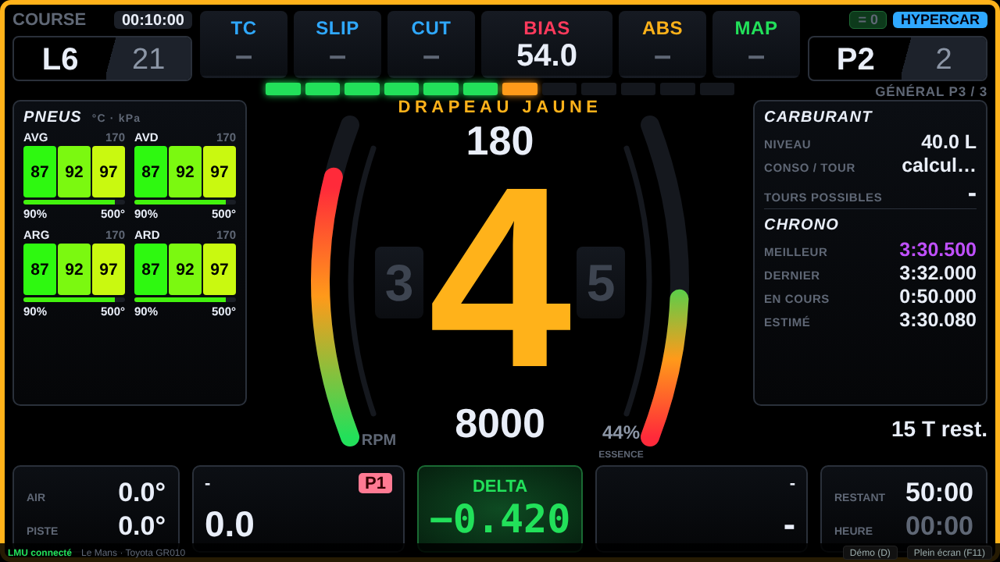

# Dashboard LMU

Dashboard de course plein écran, tout en couleur, pour **Le Mans Ultimate**, affiché dans le navigateur de ton PC (ou d'une tablette du même réseau). Il lit la **télémétrie réelle** du jeu en direct.



## Ce qui est affiché

| Zone | Contenu |
|---|---|
| LED de régime | 15 LED vert → jaune → rouge, tout clignote en **bleu** au point de passage |
| Centre | Rapport engagé (R, N, 1, 2…), vitesse km/h, régime, pédales gaz/frein, TC, ABS, map moteur, répartition de freinage, limiteur pit |
| Chrono | Tour en cours, **delta en temps réel** (vert = plus rapide, rouge = plus lent), meilleur tour, dernier tour, tour estimé, secteurs (vert = record perso, jaune = plus lent), tour invalidé |
| Course | Position générale et dans la catégorie, tour actuel, tours restants, temps restant, écarts devant/derrière, arrêts |
| Pneus | Températures intérieur / centre / extérieur (bleu froid → vert idéal → rouge chaud), pression kPa, usure, température des freins |
| Carburant | Litres restants, consommation moyenne par tour, tours possibles, et **énergie virtuelle** (Hypercars) |
| Drapeaux | Vert, jaune local, jaune plus loin, Full Course Yellow / Safety Car, bleu, rouge, damier, pénalité |
| Alertes | Surchauffe moteur, eau/huile, freins, crevaison, pneus usés, carburant/énergie bas, pénalité, dégâts, tour invalidé |

## Installation : application Windows (recommandé)

1. Télécharge **`Dashboard LMU.exe`** (onglet **Actions** du dépôt → dernière exécution → artefact *Dashboard-LMU-exe*, ou onglet **Releases**).
2. Double-clique dessus : le dashboard s'ouvre dans sa propre fenêtre. Pas de navigateur, rien à installer (Windows 10/11).
3. Lance Le Mans Ultimate et monte en piste : le voyant en bas à gauche passe à **« LMU connecté »**.

Clic droit sur l'exe → *Envoyer vers → Bureau (créer un raccourci)* pour l'avoir sur le bureau.

Raccourcis : **F11** plein écran, **D** mode démo.

Aucun plugin à installer dans le jeu : LMU publie lui-même ses données en mémoire partagée (`LMU_Data`). Garde ton jeu à jour.

### Construire l'exe toi-même

L'exe est construit automatiquement par GitHub Actions (`.github/workflows/build-exe.yml`) à chaque envoi sur `main`. Pour le construire sur ton PC : installe Python 3, puis double-clique sur `build_exe.bat` → `dist\Dashboard LMU.exe`.

### Version navigateur (optionnelle)

`start.bat` lance le pont seul et ouvre la page sur http://localhost:8080, utile pour l'afficher sur une tablette du même réseau (`http://<IP-du-PC>:8080`). Nécessite Python 3.

## Mode démo (sans le jeu)

Appuie sur **D** ou clique **Démo** en bas à droite, ou ouvre `http://localhost:8080/?demo`. Tu peux aussi ouvrir directement `web/index.html` dans le navigateur : la démo démarre seule. Elle simule des tours, le delta, l'usure, la conso et des drapeaux.

## Réglages

En haut de `web/app.js`, l'objet `CFG` regroupe les seuils : point de passage des LED (`shiftAt`, 96,5 % du régime max par défaut), plage de la barre de delta, alertes eau/huile/freins, usure, carburant.

## Comment ça marche

```
Le Mans Ultimate ──(mémoire partagée LMU_Data)──> bridge/lmu_bridge.py ──(HTTP + flux temps réel)──> navigateur (web/)
```

- `bridge/lmu_shm.py` : structures de la mémoire partagée, alignées sur l'en-tête officiel de Studio 397 (`Support\SharedMemoryInterface` dans le dossier du jeu).
- `bridge/lmu_bridge.py` : lit les données 30 fois par seconde, calcule delta, consommation et tours restants, et les envoie à la page (Server-Sent Events, `/stream`) ; sert aussi la page.
- `app/lmu_dashboard_app.py` : l'application Windows (fenêtre native pywebview + pont en arrière-plan), empaquetée en un seul .exe avec PyInstaller.
- `web/` : la page (HTML/CSS/JS sans dépendance). `demo.js` produit les mêmes données que le pont.

Le delta vient du jeu (`mDeltaBest`) ; s'il n'est pas disponible, le pont le calcule lui-même par rapport à ton meilleur tour valide de la session. La consommation est la moyenne des 5 derniers tours sans passage aux stands.

## Tests

```
python tests/test_bridge.py
```

Les tests remplissent une fausse mémoire partagée et vérifient les valeurs calculées ; ils tournent aussi sans Windows ni jeu.

## Dépannage

- **« En attente de Le Mans Ultimate… »** : le jeu n'est pas lancé, ou sa version est trop ancienne pour la mémoire partagée native. Mets-le à jour.
- **« Pont injoignable »** : la fenêtre `start.bat` a été fermée. Relance-la.
- **Valeurs incohérentes après une mise à jour du jeu** : Studio 397 a peut-être modifié la structure. Compare `bridge/lmu_shm.py` avec `Support\SharedMemoryInterface\SharedMemoryInterface.hpp` du jeu.

## Crédits

Cartographie de la mémoire partagée d'après [TinyPedal/pyLMUSharedMemory](https://github.com/TinyPedal/pyLMUSharedMemory), elle-même basée sur l'en-tête de Studio 397.
